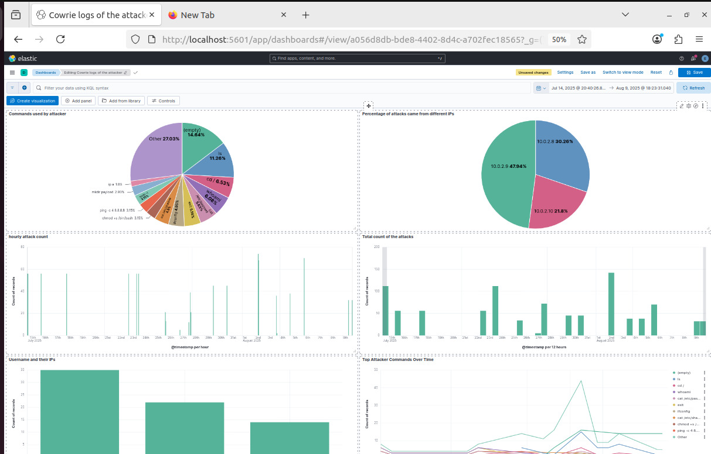
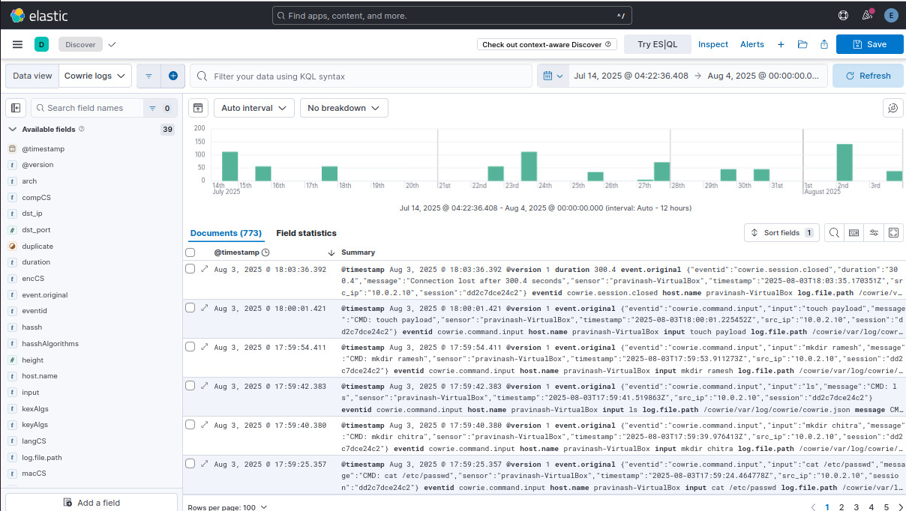

# Automated IP Blacklisting Using Honeypot Logs

A cybersecurity lab project that combines the Cowrie SSH/Telnet honeypot, Python log analysis, Linux firewall rules, and the ELK Stack to explore how suspicious activity can be identified and blocked.

> **Project status:** Educational/lab implementation. The current Python script reads Cowrie JSON events and adds an `iptables` DROP rule after an IP reaches the configured command-event threshold. It is scheduled through cron; it is not a real-time detection service or a production-ready firewall manager.

## Overview

Cowrie records activity from systems interacting with a decoy SSH/Telnet service. This project uses the resulting JSON events for two related workflows:

1. **Visibility:** Logstash forwards Cowrie events to Elasticsearch for investigation and Kibana visualisation.
2. **Response experiment:** `block_ips.py` counts `cowrie.command.input` events by source IP and adds a firewall DROP rule when the count reaches five.

## Architecture

```text
Controlled test client
        |
        v
Cowrie SSH/Telnet honeypot
        |                         Cowrie JSON log
        |                                  |
        |                                  +--> Python block_ips.py
        |                                           |
        v                                           v
     Logstash --------------------------------> iptables
        |
        v
  Elasticsearch
        |
        v
      Kibana
```

The log-visualisation and blocking paths are separate consumers of the Cowrie JSON log.

## Repository layout

```text
.
├── README.md
├── block_ips.py                 # Rule-based IP blocking script
├── cowrie-logstash.conf         # Logstash file input and Elasticsearch output
├── cowrie_cron.txt              # Example cron schedule
├── cowrie_sample.json           # Sample Cowrie JSON events
├── .gitignore
└── kibana_dashboard/
    ├── Kinana_dasboard.png
    └── Timeline_Kibana.png.jpeg
```

## Technology stack

- **Cowrie** — SSH/Telnet honeypot and event generation
- **Python 3** — Parses JSON events and applies the blocking rule
- **iptables** — Adds source-IP DROP rules
- **Logstash** — Reads Cowrie JSON events and forwards them
- **Elasticsearch** — Stores events for search
- **Kibana** — Visualises event patterns
- **cron** — Schedules periodic script execution

## Prerequisites

- An isolated Ubuntu/Linux lab or virtual machine
- Python 3
- Cowrie installed and generating `cowrie.json`
- Elasticsearch, Logstash, and Kibana installed and configured if using the ELK workflow
- Administrative permission for firewall changes

Do not expose a honeypot or test target to networks you do not control. Run experiments in an isolated, authorised lab.

## Setup

### 1. Clone this repository

```bash
git clone https://github.com/Pravinashrajendran/Automated-IP-Blacklisting-Using-honeypot-Logs.git
cd Automated-IP-Blacklisting-Using-honeypot-Logs
```

### 2. Check the Cowrie log path

The current script expects:

```text
/cowrie/var/log/cowrie/cowrie.json
```

If your Cowrie installation uses another path, update `LOG_FILE` in `block_ips.py`. Confirm that the account running the script can read the log.

### 3. Configure Logstash

Review `cowrie-logstash.conf` and adapt the input path, Elasticsearch URL, certificate path, and index naming to your environment. Set the Elasticsearch password in the Logstash service environment as `ELASTIC_PASSWORD`; never hard-code credentials in a tracked configuration file.

For a typical Linux service installation, the Elasticsearch CA certificate path may differ from the example in the configuration. Use the CA certificate for your own Elasticsearch deployment and keep certificate verification enabled.

### 4. Start the services

Start Cowrie, Elasticsearch, Logstash, and Kibana using the service commands appropriate for your installation. Service names and installation methods can differ by version and deployment.

### 5. Run the blocking script carefully

Inspect the script and test it in a disposable lab before enabling firewall changes. The script invokes `sudo iptables`, so configure permissions deliberately and verify the target host's firewall rules before running it.

```bash
python3 block_ips.py
```

The script currently uses a threshold of **five command-input events per source IP**. This is a simple demonstration heuristic, not a reliable standalone indicator of maliciousness.

### 6. Schedule with cron (optional)

`cowrie_cron.txt` contains an example schedule that runs every three minutes. Review and adapt the absolute script path, Python path, permissions, and logging before adding it to your own crontab.

## Screenshots

### Kibana dashboard



### Event timeline



## Important limitations

- The current script counts command-input events from the log on each run; it does not maintain a durable, time-windowed counter.
- The threshold is rule-based and can cause false positives.
- The script appends firewall rules and does not provide expiry, allow-list management, or automatic cleanup of old rules.
- A cron schedule introduces delay; this is not real-time response.
- `iptables` behaviour can differ on systems using nftables or other firewall managers.
- The Logstash configuration must be adapted to your own Elasticsearch TLS and authentication settings.

Treat this as a learning project, not a production security control.

## Future improvements

- Add configuration options for log path and threshold
- Track event counts over a defined time window
- Add allow-lists, rule expiry, audit logs, and safe rollback
- Add tests for malformed events and repeated IPs
- Add alerts and dashboard exports
- Document a reproducible lab setup with version-pinned dependencies

## Author

**Pravinash SMR** — Cybersecurity projects and hands-on security monitoring.
